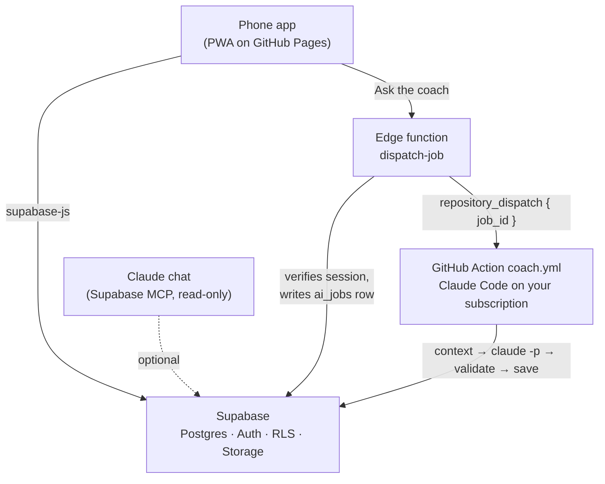
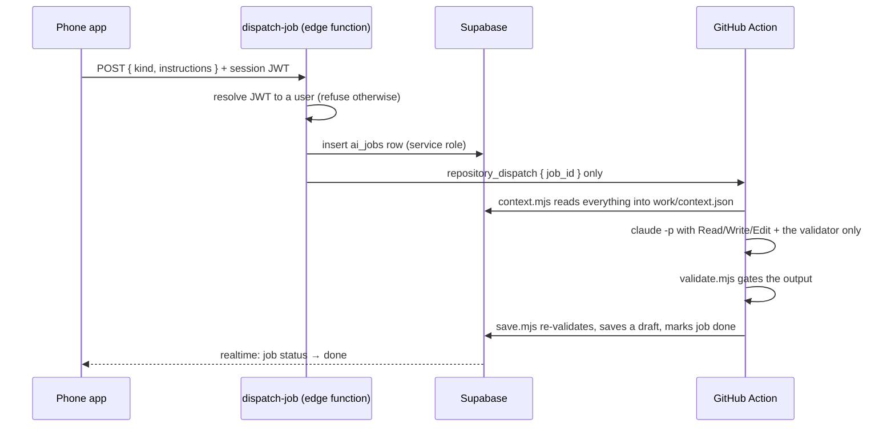

# Gym Coach

A personal strength-training app with an AI coach. A phone app and a Postgres
database handle the daily work: today's plan, logging sets and tracking
progress. That work is plain code, so it's instant and free. A Claude model
writes training blocks, check-ins and answers on demand. It runs inside a
GitHub Action and is never on the path between you and your next set.

The design rests on one idea: **a plan prescribes exercises, sets, rep ranges
and rest, but never a weight.** The load for every set is computed from what
you last logged. That way the programme and the progression can't disagree,
and the AI never has to guess what you can lift.



Three tiers, by what they cost:

| Tier | What it does | Latency | Cost |
| :-- | :-- | :-- | :-- |
| Views and engine | today's plan, next targets, weekly volume, rotation, trends | instant | free |
| App writes | logging, notes, rules edits, activating a block | instant | free |
| AI jobs | write or revise a block, check in, ask a question, revise the rules | 1–5 min | your Claude subscription |

## Contents

- [Features](#features)
- [How it works](#how-it-works)
- [Security model](#security-model)
- [Design decisions](#design-decisions)
- [Set it up for yourself](#set-it-up-for-yourself)
- [Development](#development)
- [Repository layout](#repository-layout)
- [Further reading](#further-reading)

## Features

- **Today.** The next day in your rotation, with an exact target for every
  exercise, your last logged numbers beside each one, and the rest time.
- **Workout.** Log a set in one tap ("done as prescribed"), or edit weight,
  reps and partials per set. It has a rest timer and a finish sheet for
  duration, calories, heart rate, HR zones, effort and pain. Logging works
  offline and syncs when the connection comes back.
- **Apple Watch import.** Paste the text of an Apple Fitness workout summary,
  for example from iOS Live Text, and the finish sheet fills itself in. You can
  also open the app from an iOS Shortcut with `?watch=<text>` in the URL. Or
  attach the screenshots themselves: they go to a private storage bucket, and
  the coach reads them later (see [below](#4-an-ai-job-from-start-to-finish)).
- **Block.** Shows the active training block. Drafts come with the coach's
  rationale and a weekly-volume table. You can Activate, Request changes or
  Discard each draft.
- **Progress.** A training calendar, lift charts, weekly sets per muscle
  against your target, and your body-weight trend.
- **Coach.** Leave notes, request a check-in or ask a question. You can pick
  the model (Opus or Sonnet) and the thinking effort for each job, and watch
  its status update live.
- **Settings.** A rules editor that validates against the schema, with full
  version history and one-tap rollback. Also an editor for the coaching manual
  and the exercise library.
- **Installable.** Works offline as a PWA, follows the system dark mode and
  needs no build step.

## How it works

### 1. Your coaching rules are data, not code

Every coaching number lives in one `rules` JSON document in the database. That
covers rep ranges, load increments, rest times, the per-session exercise cap,
the stall rule, deload triggers, weekly volume minimums, muscle priority,
banned movements and nutrition targets. The document is validated against
[`coach/schema/rules.schema.json`](coach/schema/rules.schema.json) every time
it is saved, by the app before it writes and again by the Action. A coaching
constant in a source file counts as a bug.

The other document is the **manual**: free-text markdown describing how you
want to be coached. Both documents are append-only. Each edit inserts a new
version, and rolling back is just another new version.

To get started, copy
[`supabase/seed/rules.example.json`](supabase/seed/rules.example.json). It's a
complete rules document with made-up values.

### 2. Today's plan: views, then the engine

Derived state lives in Postgres views and is never stored in a column. That
means logging a set changes the next target straight away.

| View | What it knows |
| :-- | :-- |
| `lift_state` | per exercise: last weight and reps, sessions since it last changed, stall count |
| `weekly_muscle_volume` | direct and indirect sets per muscle per week |
| `training_rate` | sessions per week over the last 4 and 8 weeks |
| `rotation_next` | which day of the active block comes next |
| `body_trend` | weekly average body weight and its rate of change |

[`app/js/engine.js`](app/js/engine.js) is a pure function of those views and
the rules. It takes plain data in, returns plain data, and the caller passes in
today's date. For each slot in the day it works out one target:

1. **History exists.** If every working set reached the top of the rep range,
   add one increment and drop to the bottom of the range. Otherwise keep the
   weight and aim one rep higher.
2. **Stalled.** After the number of stalled sessions set in the rules, the
   target carries the next intervention from the rules' list: move the
   exercise earlier, lengthen the rest, add a set or change the variation.
3. **No history.** A conservative opener, worked out as a fraction of the
   closest similar lift you have logged. It is always labelled as an opener.

Starting the workout saves those targets with the session, so you log against
exactly the plan you saw.

### 3. Logging works offline

Writes go to an outbox in `localStorage` first. The outbox is flushed when the
app loads and whenever the connection returns. The last Today card is cached,
so the app opens with something useful even with no signal at the gym.

### 4. An AI job from start to finish



There are four kinds of job: `block` (write a new training block),
`revise_block` (change a draft based on your comment), `checkin` (review the
recent weeks) and `ask` (answer a question). An `ask` job can also target the
rules or the manual. It then saves a new version of that document, and you
can roll it back in Settings. Rules versions are checked against the schema
before they are saved.

The steps:

- **[`dispatch-job`](supabase/functions/dispatch-job/index.ts)** is the only
  route from the phone to the Action. The app can't insert into `ai_jobs`
  itself, so every queued job has an Action behind it. The GitHub payload
  carries only a job id. Your instructions stay in the database, because
  dispatch payloads end up in a public repository's event history.
- **[`coach/context.mjs`](coach/context.mjs)** marks the job `running` and
  writes `work/context.json`. That file holds the rules and the manual, eight
  weeks of sessions and sets, lift state, volume measured against your targets,
  your training rate, body trend, current and previous blocks, recent
  decisions and any unread coach notes. If your three most recent sessions
  with screenshots attached have any, those images are downloaded into
  `work/` as well.
- **`claude -p`** runs with a prompt from [`coach/prompts/`](coach/prompts).
  The model has Read, Write, Edit and exactly one shell command, the validator.
  MCP and web tools are switched off. It writes its output and runs the
  validator itself until the output passes.
- **[`coach/validate.mjs`](coach/validate.mjs)** checks a block against your
  own rules. It enforces the exercise cap, banned movements and rest bounds. It
  checks weekly volume per priority muscle at the rate you *actually* train at,
  and that priority order is respected. It checks that core and mobility work
  sits in the warm-up, and above all that **the plan contains no weights
  anywhere**.
- **[`coach/save.mjs`](coach/save.mjs)** runs every check again and ignores the
  model's claim that it passed. It then stores the block as a **draft**, along
  with its rationale and a decision-log entry, and marks the job `done`. You
  press Activate. If a check-in has read workout stats off attached
  screenshots, `save.mjs` also writes those numbers onto the matching
  sessions.

If anything fails, the job is marked `failed` and a short reason is written to
the `ai_jobs` row, never to the log.

## Security model

The repository is public. The data is not.

- **One user.** Public sign-ups are off ([`supabase/config.toml`](supabase/config.toml)).
  You create your account by hand.
- **Row-level security on every table**, with `user_id = auth.uid()` for every
  operation. Every view is `security_invoker`, so it follows the same rules. A
  test confirms that an anonymous client reads nothing and can write nothing.
- **Screenshots are private.** Watch screenshots go to the `shots` storage
  bucket. It has no public access, and an owner-only policy covers every
  object.
- **The anon key in [`app/js/config.js`](app/js/config.js) is public.** Like a
  Firebase web config, it identifies the project but grants nothing without a
  signed-in session.
- **Real secrets never enter the repo.** The service-role key, the Claude OAuth
  token and the GitHub token live only in GitHub Secrets and Supabase secrets.
- **Action logs reveal nothing.** Workflow logs on a public repo can be read by
  anyone. So the coach scripts print only a job id and a status word, the
  model's output goes to a file that is never printed or uploaded, and errors
  go to the `ai_jobs` row. Tests check all of this.
- **The coach workflow has narrow triggers.** It runs only on
  `repository_dispatch` and `workflow_dispatch`. It has no
  `pull_request_target`, `issue_comment` or `schedule` trigger, so a fork or an
  outside contributor can never reach the secrets.
- **No personal data in git.** Every example, seed and test fixture uses
  invented values.

## Design decisions

| Decision | Why | Trade-off |
| :-- | :-- | :-- |
| Plans never contain weights | progression is arithmetic over logged data, so the AI can't prescribe a load you can't lift | the AI can't override a target directly; it has to change the rules or the plan structure instead |
| AI runs in a GitHub Action, not an API call from the app | it uses a Claude subscription instead of metered API keys, there is no server to run, and the model gets a sandbox with a validator | jobs take minutes, not seconds |
| The model's output goes through a validator twice | the model fixes its own failures, and `save.mjs` never trusts its claim | some jobs use more turns |
| Derived state lives in views | nothing to keep in sync, and a logged set takes effect immediately | the more complex logic, such as stall counting, is written in SQL |
| Vanilla JS, no build step | the same ES modules run in the browser and under `node --test`, and the app deploys by copying a folder | no framework conveniences |
| Rules are versioned and append-only | every change can be audited and rolled back | the documents table only grows |

**Limitations.** It is built for exactly one person per Supabase project. It is
not a multi-tenant service.

## Set it up for yourself

### What you need

- A GitHub account. The [GitHub CLI](https://cli.github.com/) (`gh`) is
  optional but makes setting secrets easier.
- A [Supabase](https://supabase.com/) project. The free tier is enough.
- A Claude **Pro or Max** subscription and
  [Claude Code](https://docs.claude.com/en/docs/claude-code), for
  `claude setup-token`.
- Node.js 24 or newer.

### 1. Copy the repository

Use **Use this template** or **Fork**, then clone your copy. On a fork, GitHub
switches Actions off until you turn them on in the **Actions** tab.

```bash
git clone https://github.com/<you>/gym-coach.git
cd gym-coach
npm install
```

### 2. Create the database

1. Create a Supabase project.
2. In **Authentication**, make sure sign-ups are disabled, then add your own
   user with an email and password under **Users → Add user**.
3. Push the schema, which creates the tables, RLS policies, views and the
   private storage bucket:

   ```bash
   npx supabase login
   npx supabase link --project-ref <your-project-ref>
   npx supabase db push
   ```

### 3. Point the app at your project

> **Do this before you deploy.** [`app/js/config.js`](app/js/config.js) ships
> pointing at the original author's project. If you skip this step your app
> will try to talk to someone else's backend, where you can't sign in.

Replace `SUPABASE_URL` and `SUPABASE_ANON_KEY` with your project's URL and
anon (publishable) key from **Project Settings → API**.

### 4. Give the coach its secrets

Keep secrets out of your shell history. Let the CLI prompt you for them, or
read them from a gitignored file.

**GitHub repository secrets** (each command prompts for the value):

```bash
claude setup-token                       # prints a long-lived OAuth token
gh secret set CLAUDE_CODE_OAUTH_TOKEN    # paste the token
gh secret set SUPABASE_URL               # https://<ref>.supabase.co
gh secret set SUPABASE_SERVICE_ROLE_KEY  # Project Settings → API → service_role
```

You can also add them in **Settings → Secrets and variables → Actions**.

**Supabase secrets for the edge function.** Create a
[fine-grained personal access token](https://github.com/settings/personal-access-tokens)
limited to **your copy of this repository only**, with **Contents: read and
write**. That is the permission GitHub requires to send a
`repository_dispatch`. Put it in a file whose name starts with `.env`, which
the `.gitignore` already excludes:

```bash
# .env.dispatch  (gitignored)
GH_DISPATCH_TOKEN=github_pat_...
GH_REPO=<you>/gym-coach
```

```bash
npx supabase secrets set --env-file .env.dispatch
npx supabase functions deploy dispatch-job
```

### 5. Deploy the app

In **Settings → Pages**, set the source to **GitHub Actions**. Every push to
`main` that touches `app/` deploys it. The workflow's config check only
catches the literal `PROJECT_REF` placeholder. It **won't** catch a
`config.js` that still points at the original project, so make sure you've
done step 3. Open the Pages URL
on your phone and use **Add to Home Screen** to install it.

### 6. Write your rules

Sign in, open **Settings** and paste in a rules document. Starting from
[`supabase/seed/rules.example.json`](supabase/seed/rules.example.json) is
easiest. Edit the numbers to match how you train; the editor won't save
anything that fails the schema. Add some exercises, and optionally write a
manual describing your goals, injuries to work around and coaching style.

### 7. Check it end to end

1. Open **Block** and tap **Generate a block**, then describe what you want. Watch the job go
   from `queued` through `running` to `done`.
2. Read the draft's rationale and volume table, then press **Activate**.
3. **Today** now shows day one. Start it and log a set.
4. Open the run in your repository's **Actions** tab. The log should contain
   only a job id and status words. If you see any of your own data there, stop
   and open an issue.

If a job fails, its reason is shown on the Coach screen. That reason comes from
the `ai_jobs` row, not the Action log.

### Optional: talk to your data in Claude

Connect the Supabase MCP server to a Claude Project **in read-only mode**, and
paste in [`docs/claude-project-instructions.md`](docs/claude-project-instructions.md).
That gives you a chat that reasons over your real logs and treats your rules as
binding.

### Optional: import existing history

[`migrate/`](migrate/README.md) is a one-off importer from a Notion training
workspace. It is idempotent, writes only to gitignored `migrate/out/`, and
produces a verification report before anything is trusted. It's a starting
point to adapt if your history lives somewhere else.

## Development

```bash
npm install
npm test                                        # node --test, no framework
npm run validate:rules -- path/to/rules.json    # check a rules document against the schema
python -m http.server 5173 --directory app      # serve the app locally
```

- `app/` is vanilla HTML, CSS and ES modules. Screens are string builders, and
  they are tested by rendering against a stubbed store.
- Bump `VERSION` in [`app/sw.js`](app/sw.js) whenever the app changes, so
  installed phones pick up the update.
- Every file in `app/js/` must be in the service worker's precache list. A test
  enforces this.
- [`CLAUDE.md`](CLAUDE.md) lists the project's invariants, the rules that are
  easy to break by accident. It's worth reading before you change anything.

## Repository layout

```
app/                 the phone app: static PWA, no build step
  js/engine.js       pure progression maths: targets, volume, rotation
  js/store.js        Supabase client, auth, realtime, offline outbox
  js/screens-*.js    today, workout, block, progress, coach, settings
  js/rules-check.js  dependency-free rules validator, shared with the Action
coach/               the AI runner (runs only in the Action)
  context.mjs        builds work/context.json for a job
  validate.mjs       gates a block or rules document against the rules
  save.mjs           re-validates and stores the result
  prompts/           one prompt per job kind
  schema/            JSON Schemas for rules and blocks
supabase/
  migrations/        tables, RLS, views
  functions/         dispatch-job edge function
  seed/              rules.example.json (fabricated values)
migrate/             one-off Notion importer
test/                node --test suites
.github/workflows/   test.yml, pages.yml, coach.yml
docs/                specification and build notes
```

## Further reading

- [`docs/spec.md`](docs/spec.md): the full specification, covering every
  table, view, gate and pipeline in detail.
- [`docs/plan.md`](docs/plan.md): the task-by-task plan the project was built
  from.
- [`CLAUDE.md`](CLAUDE.md): the working rules for anyone, human or agent,
  changing the code.

## Not medical advice

This is a training log that does arithmetic on numbers you type in. It is not
medical, physiotherapy or nutrition advice. Nobody qualified in any of those
fields has reviewed it, and the model that writes training blocks can be
wrong. If something hurts, stop and see a professional. Use it at your own
risk.

## Licence

MIT. See [LICENSE](LICENSE).
