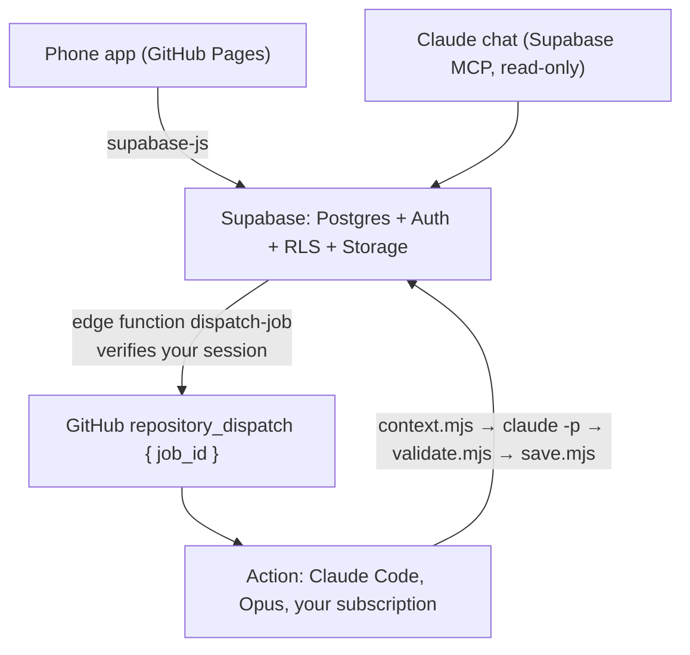

# Gym Coach

A personal training app. A phone app and a Postgres database do the day-to-day
work — today's plan, logging, progress — in plain code that runs instantly and
for free. A coach model writes training blocks and check-ins on demand, in a
GitHub Action, and never touches the fast paths.

The idea it is built around: **a plan prescribes exercises, sets, rep ranges and
rest, and never a weight.** Loads are computed from what was actually logged, so
the programme and the progression can never disagree.



Three tiers, by what they cost:

| Tier | What it does | Latency | Cost |
| :-- | :-- | :-- | :-- |
| Views and engine | today's plan, next targets, volume, rotation, trends | instant | free |
| App writes | logging, notes, rules edits, activating a block | instant | free |
| AI jobs | generate or revise a block, check in, ask a question | 1–5 min | your subscription |

## How it works

**Every coaching number is data, not code.** Rep ranges, increments, rest, the
per-session exercise cap, the stall rule, deload triggers, weekly volume
minimums, muscle priority, banned movements, nutrition targets — all of it lives
in a `rules` document in the database, validated against
[a JSON Schema](coach/schema/rules.schema.json) on every save. You edit the
rules in the app; the code reads them. A coaching constant in a source file is a
bug, and the tests check for several of them.

**Derived state is a view, never a column.** `lift_state` knows what you last
lifted and whether it has stalled. `weekly_muscle_volume` counts direct and
indirect sets. `rotation_next` knows which day comes next. Nothing is
hand-maintained, so logging a set changes the next target immediately.

**The coach is gated.** A block it writes is checked against your own rules —
exercise cap, banned movements, rest bounds, weekly volume at the rate you
actually train at, priority order, and the no-weights rule — before it is
stored. It lands as a draft. You press Activate.

## Layout

```
app/          the phone app: vanilla HTML/CSS/JS, no build step, installable
coach/        the AI runner: context, validator, save, prompts, schemas
supabase/     migrations, the dispatch-job edge function, a fabricated example rules file
migrate/      a one-off importer, for moving in from somewhere else
test/         node --test, no framework
```

## Running it yourself

You need a Supabase project and a Claude subscription. Everything else is in the
repository.

1. **Create a Supabase project.** In Authentication, turn off public sign-ups
   and create your own user by hand. This is a single-person app; nothing in it
   is built for a second account.
2. **Push the schema.**
   ```bash
   npx supabase link --project-ref <your-project-ref>
   npx supabase db push
   ```
3. **Point the app at it.** Put your project URL and anon key in
   [`app/js/config.js`](app/js/config.js). These are public identifiers, like a
   Firebase web config — every table and view is behind row-level security, so
   the anon key reads nothing without your session.
4. **Give the coach a way in.**
   - Run `claude setup-token` and store the result as the repository secret
     `CLAUDE_CODE_OAUTH_TOKEN`.
   - Store `SUPABASE_URL` and `SUPABASE_SERVICE_ROLE_KEY` as repository secrets.
   - Create a fine-grained personal access token scoped to this repository only,
     with **Contents: write** — the permission GitHub requires for
     `POST /repos/{owner}/{repo}/dispatches` — then:
     ```bash
     npx supabase secrets set GH_DISPATCH_TOKEN=<token> GH_REPO=<owner>/<repo>
     npx supabase functions deploy dispatch-job
     ```
5. **Turn on GitHub Pages** with the "GitHub Actions" source. Pushing to `main`
   deploys `app/`.
6. **Write your rules.** Open Settings in the app and paste in a rules document.
   [`supabase/seed/rules.example.json`](supabase/seed/rules.example.json) is a
   complete example with made-up values to start from.

### Working on it

```bash
npm install
npm test                      # node --test
python -m http.server 5173 --directory app
```

## Privacy

This repository contains no personal data, by design and by test. Training
numbers, body metrics, injuries, the coaching manual and the rules all live in
Supabase behind row-level security. The Action that runs the coach never prints
anything it reads: its scripts print a job id and a status word, the model's
output goes to a file that no step reads back, and errors travel in a database
row rather than a log line. That matters because workflow logs on a public
repository are readable by anyone.

## Not medical advice

This is a personal training log that does arithmetic on numbers you type in. It
is not medical, physiotherapeutic or nutritional advice, it has not been
reviewed by anyone qualified to give any of those, and the model that writes the
training blocks can be wrong. If something hurts, stop, and ask a professional.
Use it at your own risk.

## Licence

MIT. See [LICENSE](LICENSE).
